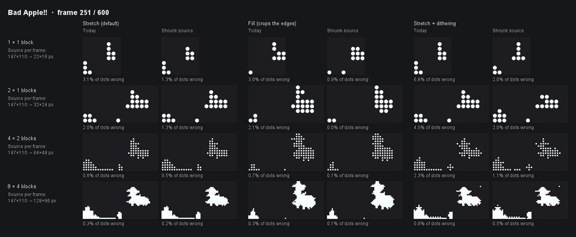
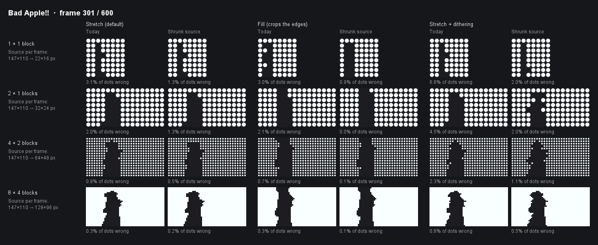
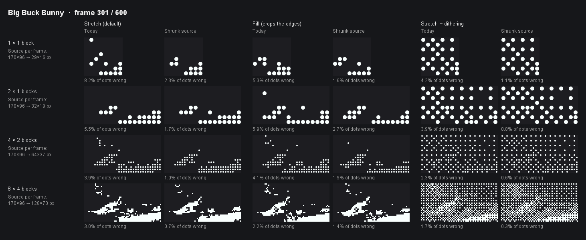

### Saved videos keep only the detail their board can show

The editable copy of a video is now shrunk to twice the board's dots, both across and down. Boards of 64 blocks or more keep today's source unchanged. Each comparison renders the same 60 seconds through the real import pipeline, today on the left and with the shrunk source on the right. "Wrong" counts dots that differ from the most faithful result possible at that dot count: the full source averaged over each dot's exact area.

| Bad Apple!! | Big Buck Bunny |
| --- | --- |
|  |  |

Dots wrong across the clip, default Stretch framing:

| Board | Bad Apple!! today | Bad Apple!! shrunk | Big Buck Bunny today | Big Buck Bunny shrunk |
| --- | --- | --- | --- | --- |
| 1 × 1 | 3.14% | 1.27% | 8.15% | 2.25% |
| 2 × 1 | 2.00% | 1.30% | 5.51% | 1.68% |
| 4 × 2 | 0.79% | 0.51% | 3.90% | 1.03% |
| 8 × 4 | 0.28% | 0.17% | 2.99% | 0.66% |

Fill and dithering show the same pattern: the shrunk source is closer in all 24 combinations tested. In game, Bad Apple on a 4 × 2 board now saves 394 KB in total, where its source alone used to take 1.15 MB.

Full one-minute comparisons:

<!-- drop: source-shrink-bad-apple.mp4 -->

<!-- drop: source-shrink-bunny.mp4 -->
