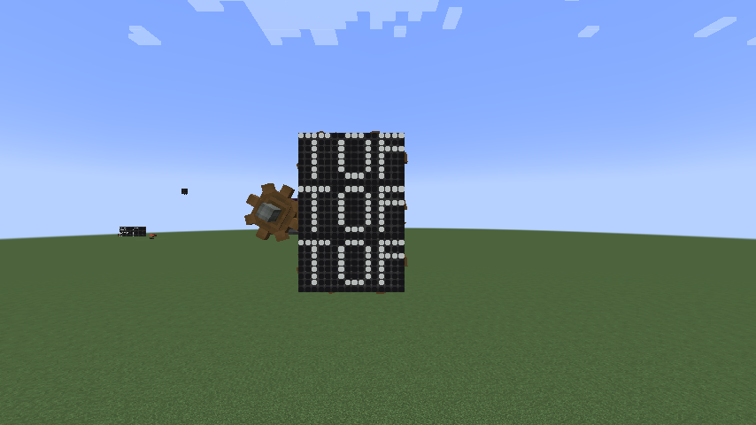
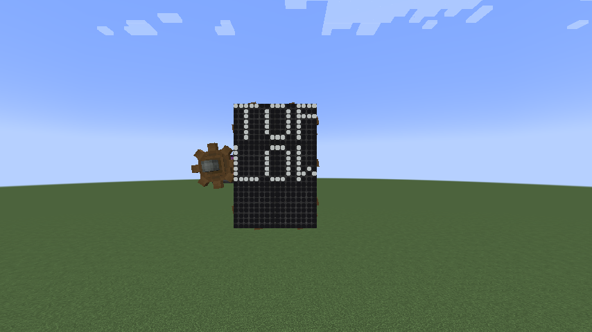
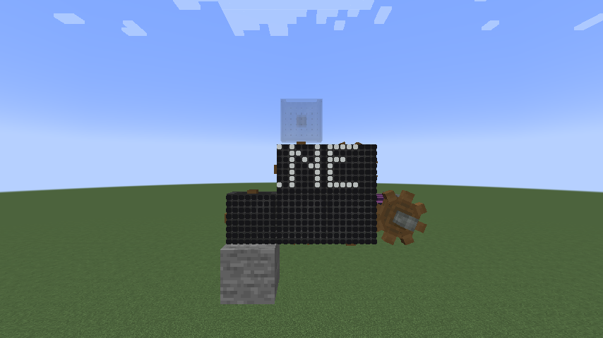
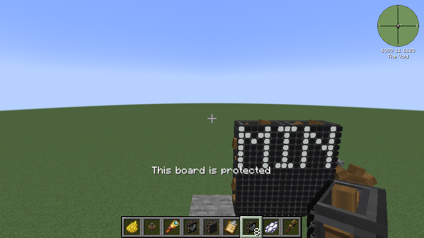

### Display Link text

Display Link text from Nixie tubes (top to bottom: 3×2 board, 1×1, progress-bar symbols, `§` codes and a tab, a line break, numbers with `°`, a translated component, styled text, emoji and CJK, accents, long text).

| Before | After |
| --- | --- |
|  |  |

Block characters from Create's progress bars, plus the check mark, arrow and square from the factory gauge source:

Real sources: Create's kinetic speed, content observer item list, and stockpile switch fill level as a percentage and a progress bar:

### Boiler gauges

Empty bar slots used to differ only by color, which a board can't show. They now draw as a dot on the baseline.

| Before | After |
| --- | --- |
|  |  |

### Quarter turns

A 3×2 board turned 90° on a bearing keeps its lines of text in order.

| Before | After |
| --- | --- |
|  |  |

### Trains

Boards on contraptions could lose their discs until the fix.

| Before | After |
| --- | --- |
|  |  |

### Claims

Placing a tile next to a claimed board used to join it. It's now refused.

| Before | After |
| --- | --- |
|  |  |

### Media Tools setting

| First import | Setting off |
| --- | --- |
|  |  |
