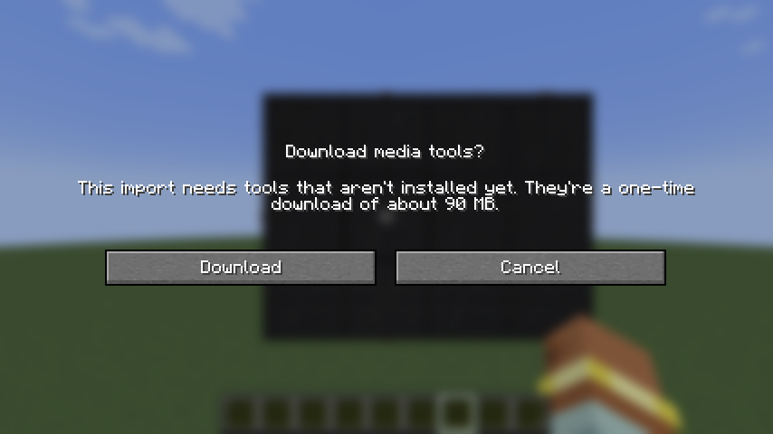
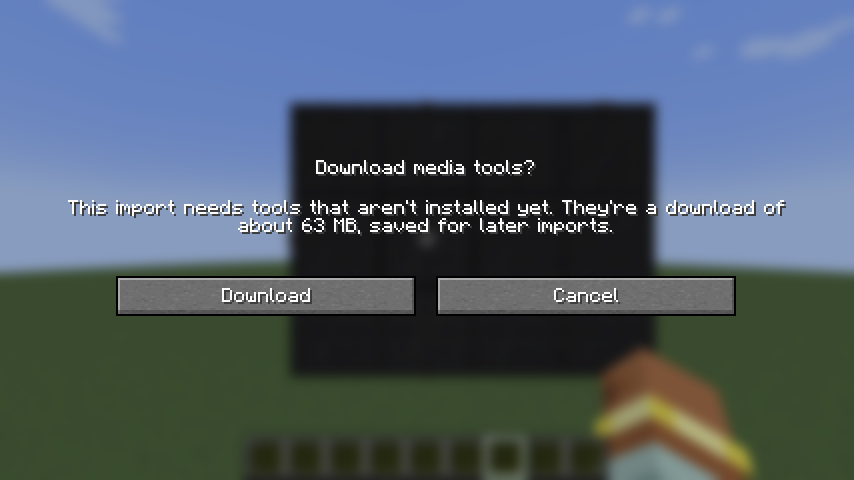
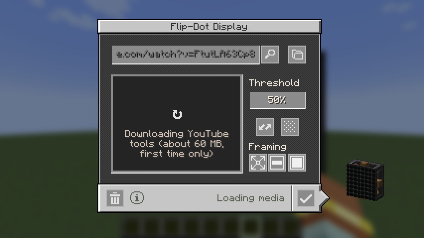
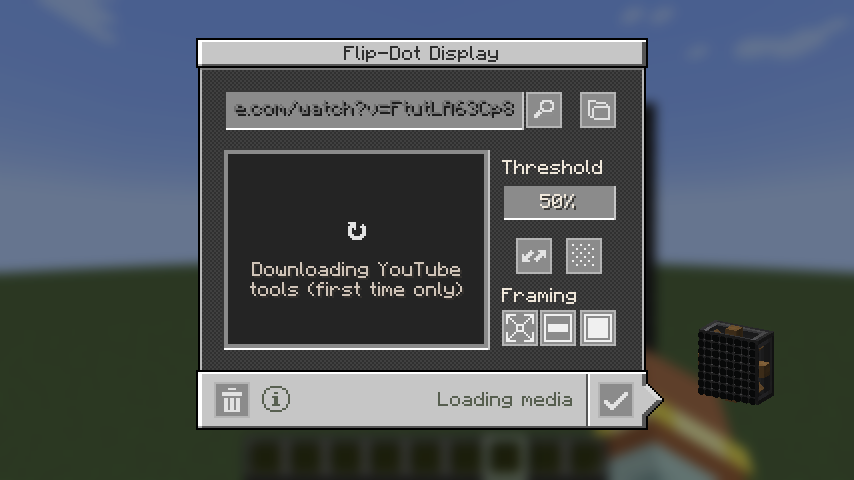
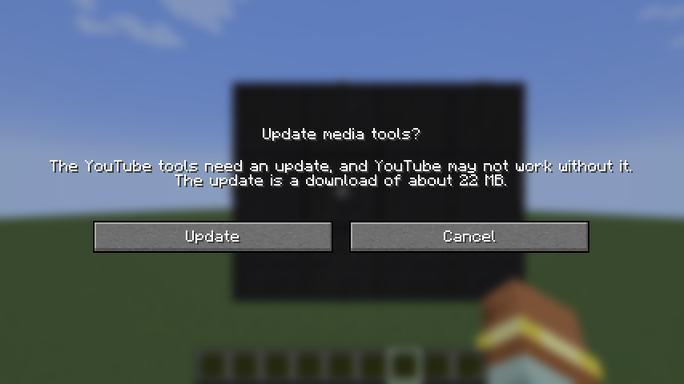
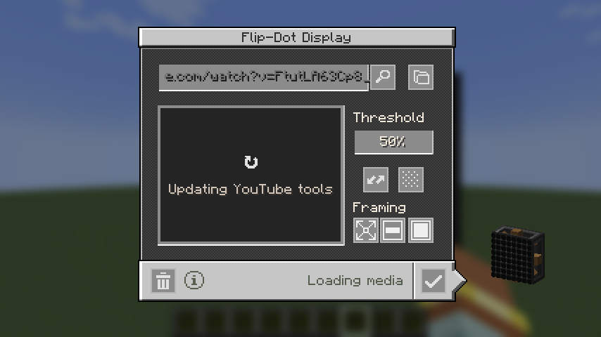

The YouTube tools popup now shows the real download size, and a newer yt-dlp from the version list is offered as an update.

| Before: first YouTube import | After: first YouTube import |
| --- | --- |
|  |  |
|  |  |

The before popup also counted ffmpeg (30 MB), which was already installed for the after shot. YouTube's share is now
the listed size for the player's platform: 63 MB on Windows, 72 to 79 MB on macOS and Linux, not a fixed 60 MB.

| After: a newer yt-dlp is listed | After: updating |
| --- | --- |
|  |  |
