### Display Link text

Display Link text from Nixie tubes (top to bottom: 3×2 board, 1×1, progress-bar symbols, `§` codes and a tab, a line break, numbers with `°`, a translated component, styled text, emoji and CJK, accents, long text).

| Before | After |
| --- | --- |
| 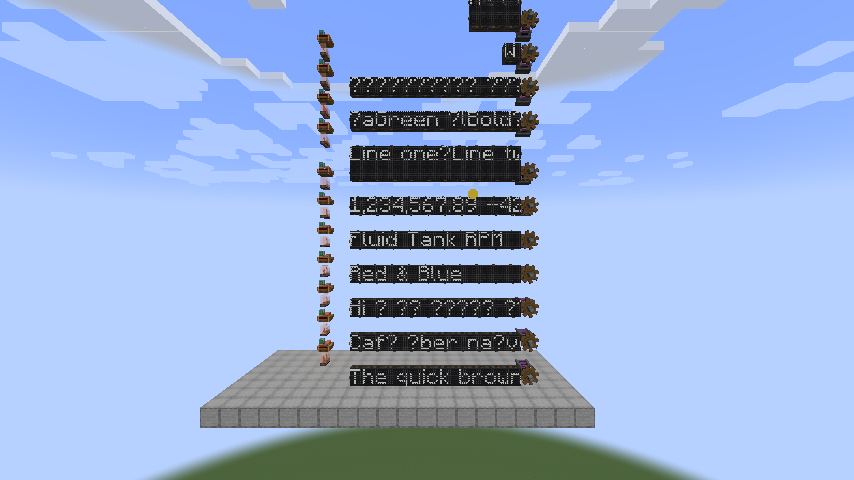 | 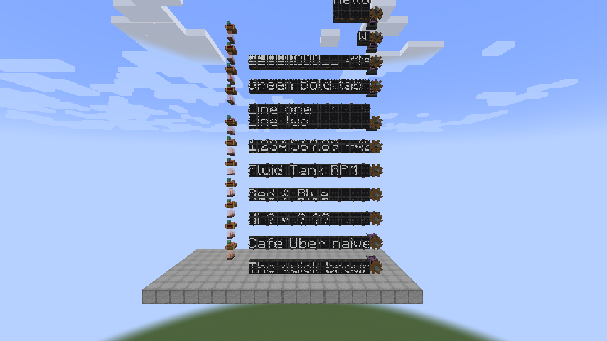 |

Block characters from Create's progress bars, plus the check mark, arrow and square from the factory gauge source:

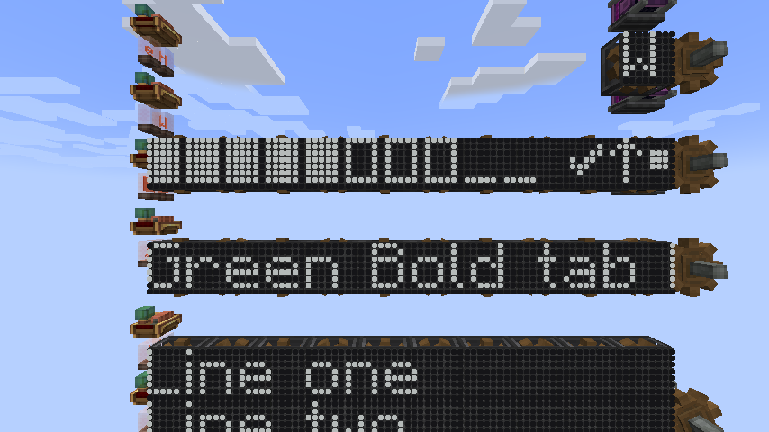

Real sources: Create's kinetic speed, content observer item list, and stockpile switch fill level as a percentage and a progress bar:

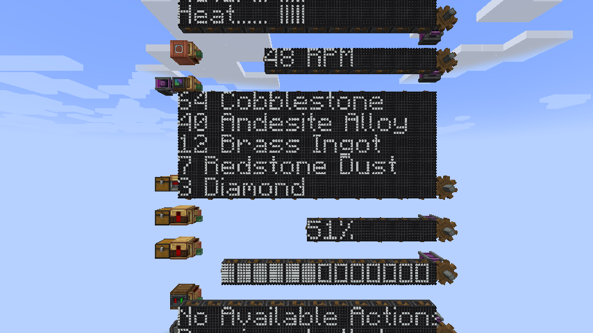

### Boiler gauges

Empty bar slots used to differ only by color, which a board can't show. They now draw as a dot on the baseline.

| Before | After |
| --- | --- |
| 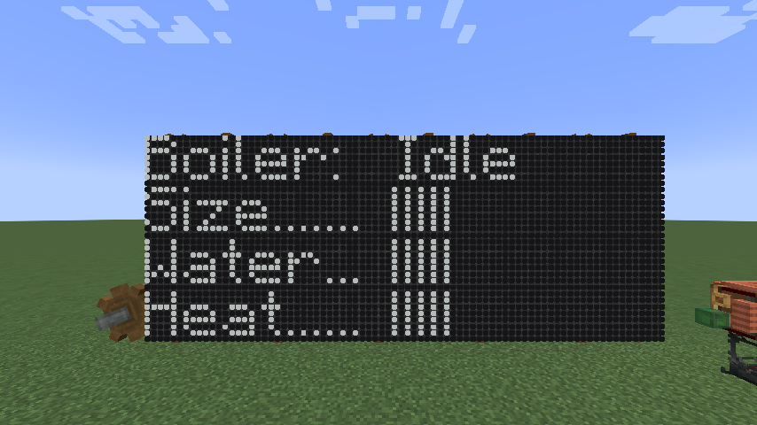 | 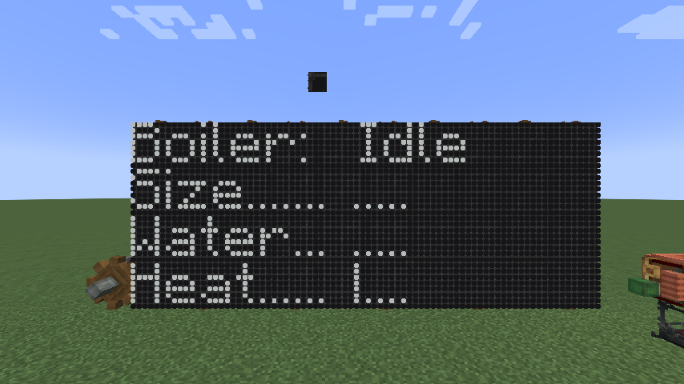 |

### Quarter turns

A board turned 90° on a bearing now clears, like Create's display boards.

| Our board, before the turn | Our board, after | Create's board, after |
| --- | --- | --- |
| 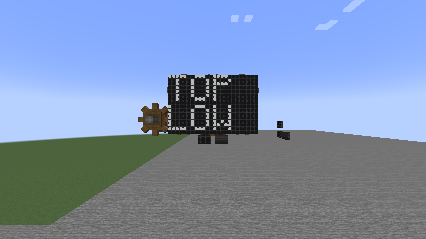 | 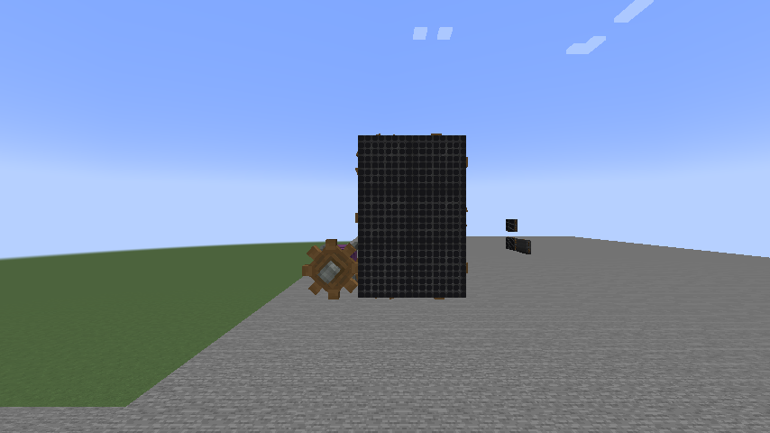 | 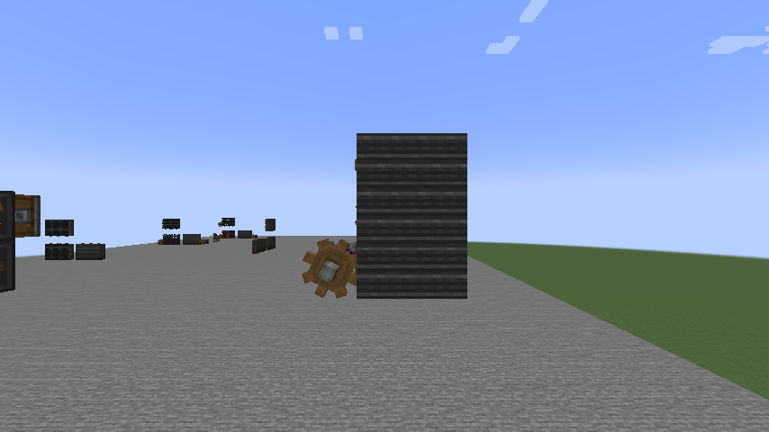 |

### Trains

Boards on contraptions could lose their discs until the fix.

| Before | After |
| --- | --- |
| 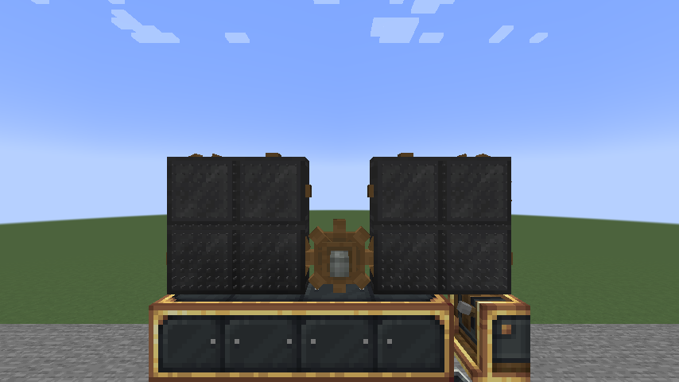 | 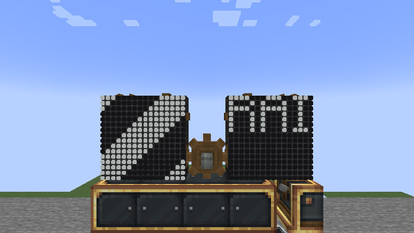 |

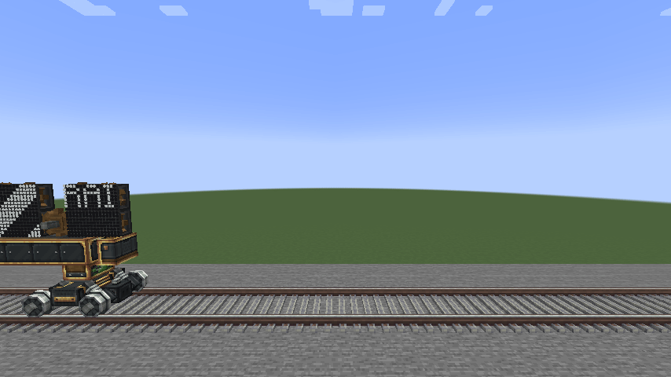

### Claims

Claim mods can't tell the client that a board is protected, so the placement ghost still shows, and the click is refused.

| Aiming at a claimed board | Clicking the board | Clicking the ground beside it |
| --- | --- | --- |
| 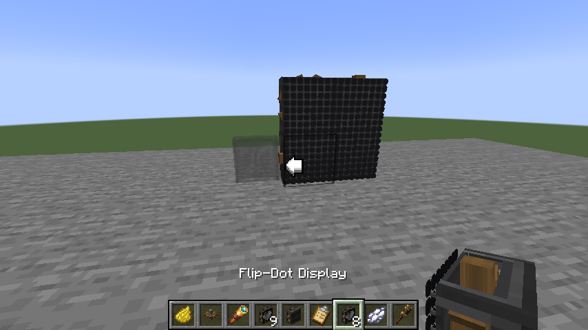 | 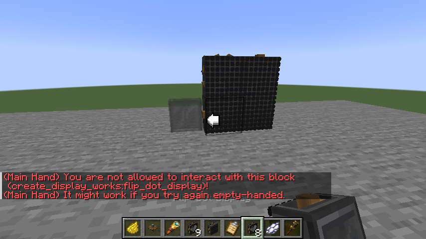 | 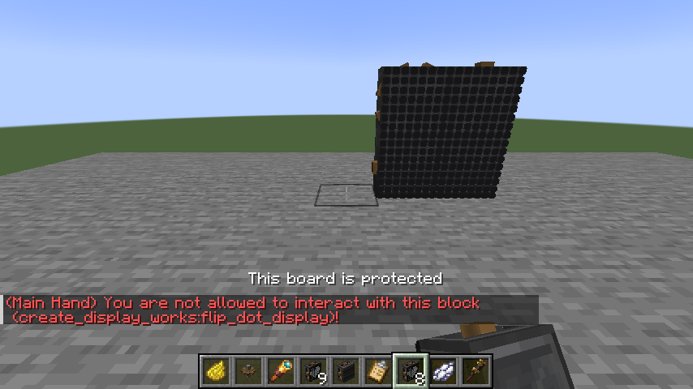 |

### Media Tools

The first import that needs tools now asks first, instead of a note on the empty screen. Turning Media Tools off still gives an error when importing.

| Before | After | Setting off |
| --- | --- | --- |
| 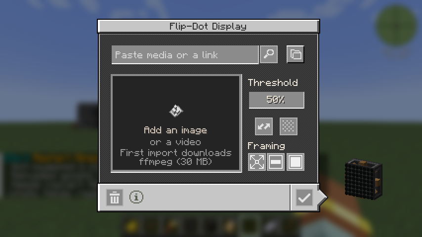 | 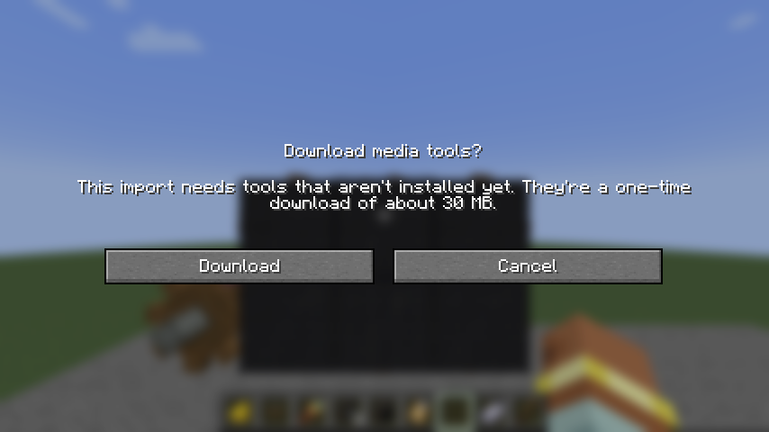 | 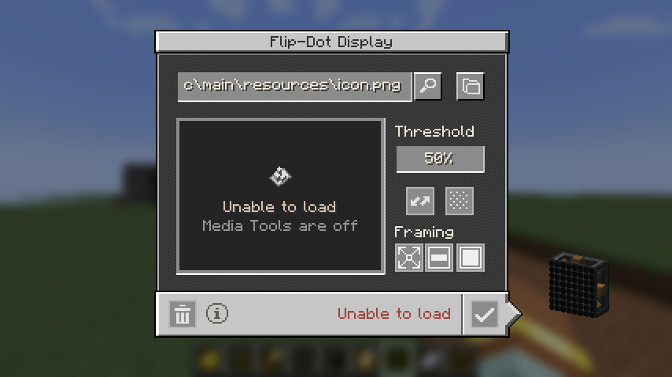 |

### Schematicannon

Printed boards match Create's: same blocks and cost, blank content. The tile borders now match the source board.

| Source | Printed | Written to after printing |
| --- | --- | --- |
| 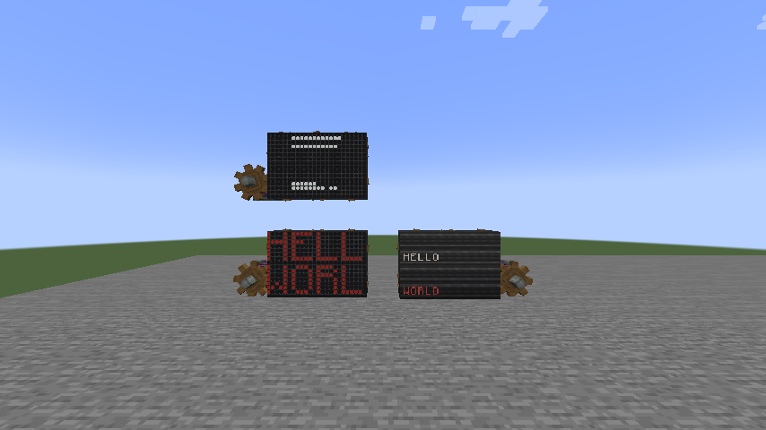 | 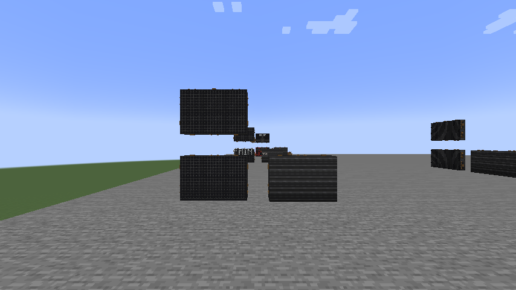 | 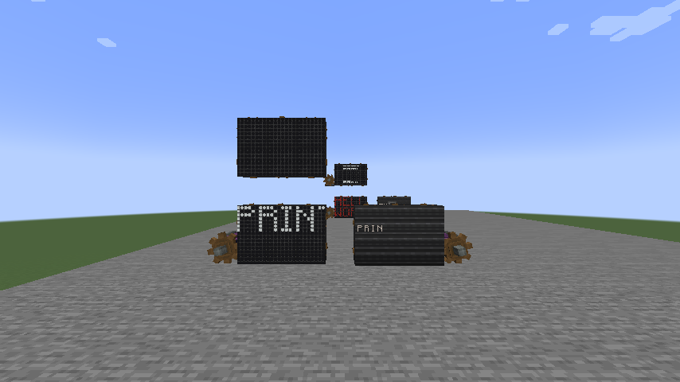 |
