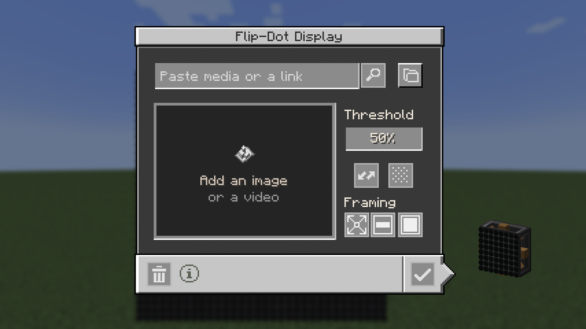
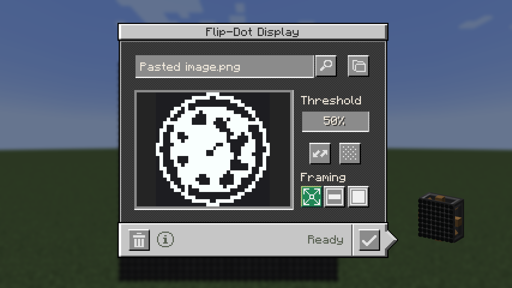

Copying an image and pressing Cmd+V (Ctrl+V on Windows and Linux) in the Flip-Dot Display screen loads it straight into the preview.

| Copied image | Screen before Cmd+V | Screen after Cmd+V |
| --- | --- | --- |
|  |  |  |

Captured on macOS through the dev control API's `/key?key=v&mods=shortcut`, with the PNG on the system clipboard. Windows and Linux clipboard reading is untested.
