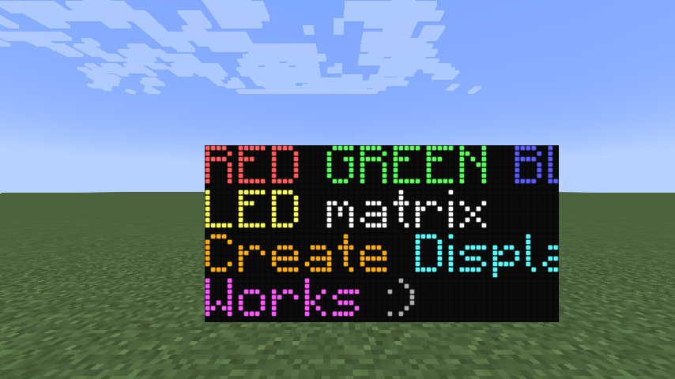
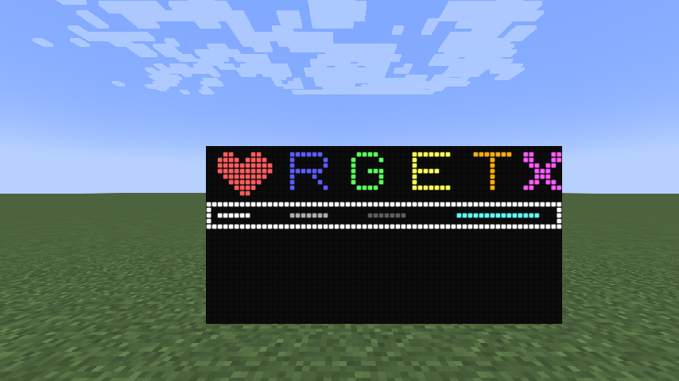
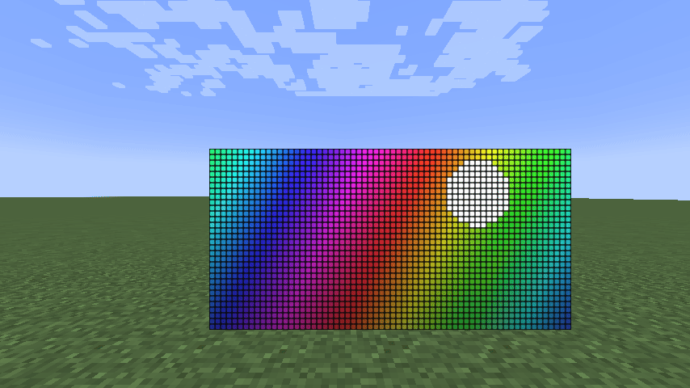
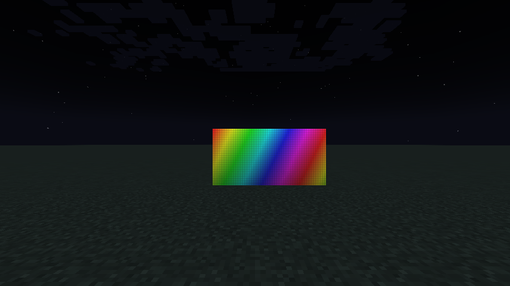
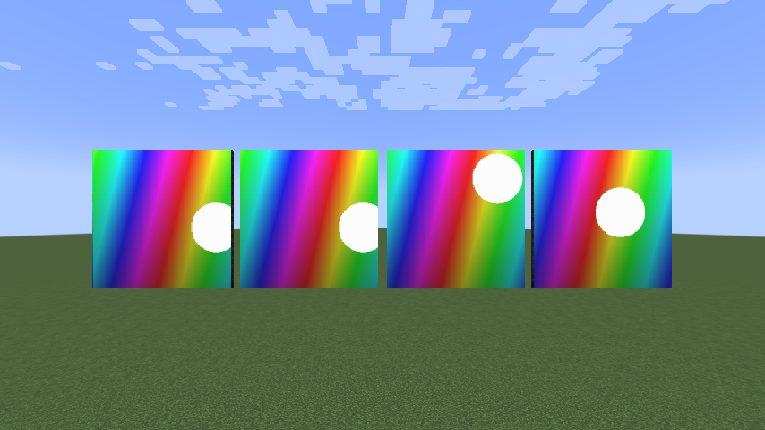
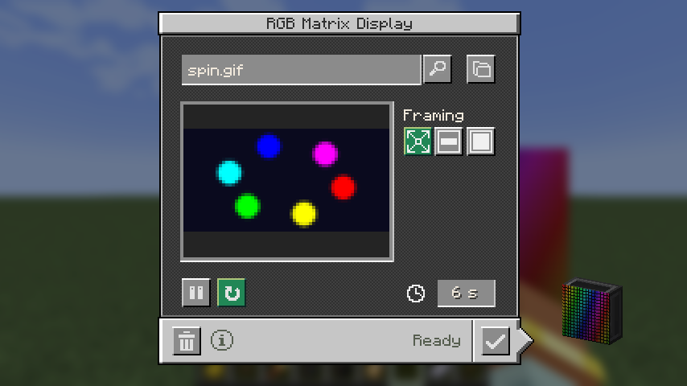
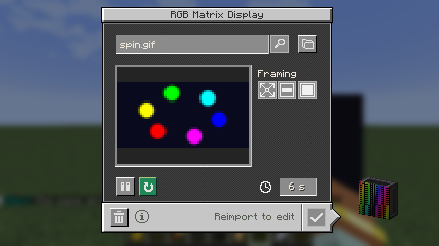
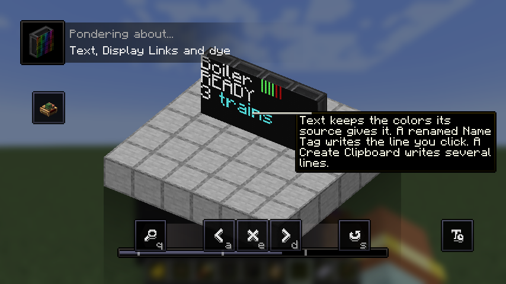
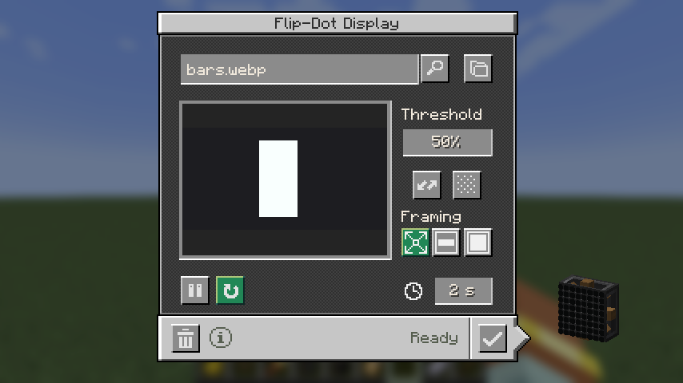

There was no RGB matrix display before this change; the flip-dot display it sits beside is unchanged.

| Colored Display Link text | Clipboard drawing with color codes |
| --- | --- |
|  |  |

| Glows at night | Large walls, LED grid faded at distance |
| --- | --- |
|  |  |

| Color media screen | Reopened: the playing clip, from the client's download |
| --- | --- |
|  |  |

| Ponder | Flip-dot media screen, unchanged |
| --- | --- |
|  |  |

Frame times with 1,024 tiles all playing video: [perf.json](perf.json)
