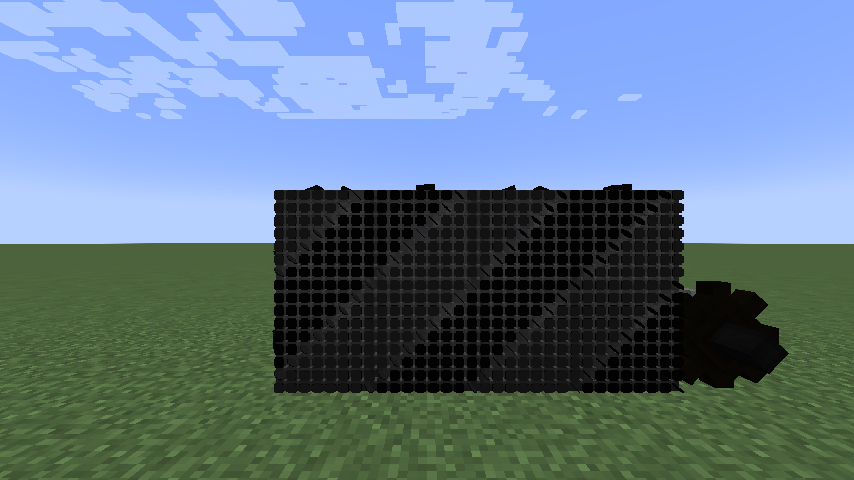
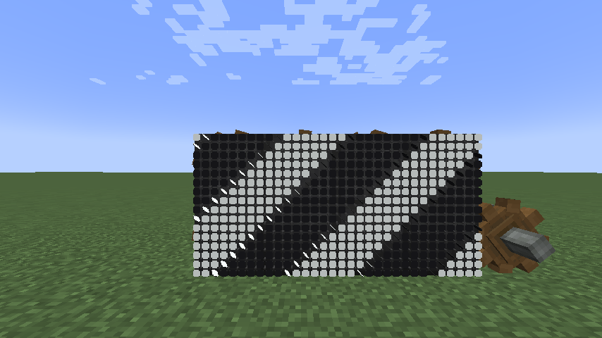
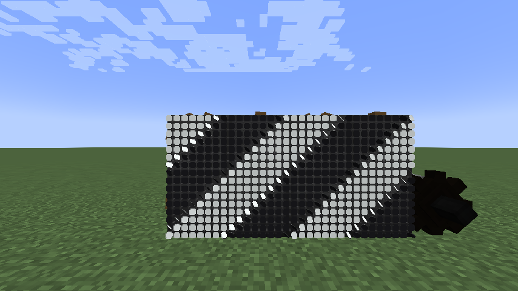
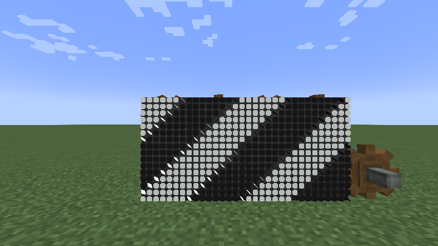

A board built in chunks that just loaded, such as the `board` fixture right after joining, on Flywheel's `indirect` backend:

| Before | After |
| --- | --- |
|  |  |

The same check on the other backends after the fix:

| `flywheel:instancing` | Flywheel off |
| --- | --- |
|  |  |

The cogwheel next to the board is Create's own `create:cogwheel`. It can still draw black in fresh chunks, because Flywheel leaves Create's visuals unlit in the same way.
