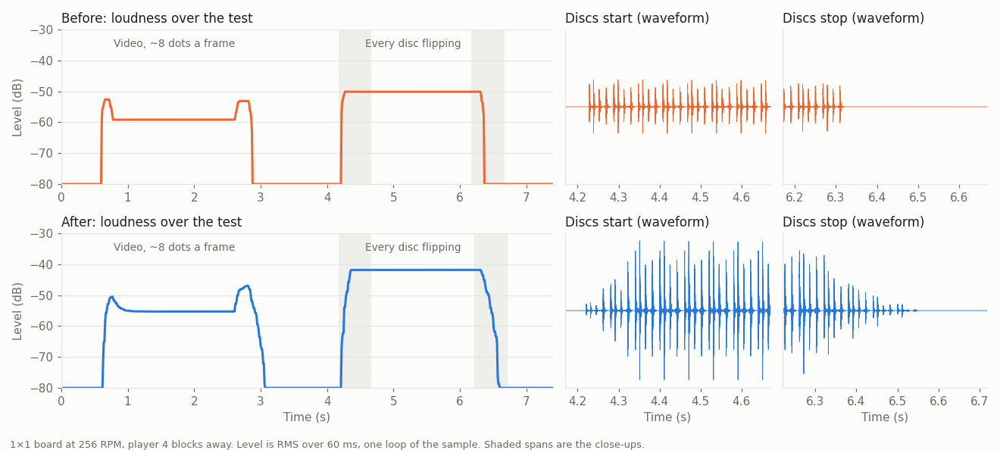

The disc rattle on a 1×1 board at 256 RPM, recorded in game from 4 blocks away: a video changing about 8 dots a frame, a still image, then a video flipping every disc.

Listen: [before](rattle-before.mp3) · [after](rattle-after.mp3) (both raised by the same 15 dB, since the game's recording is quiet)

- The rattle fades in over 3 ticks and out over 6, instead of starting and stopping at full volume.
- Flipping every disc is 12 dB louder than the 8-dot video, up from 9 dB. A whole frame scored against 2 dots is at least 12 dB louder on any board size.
- After breaking the board, picking it up with a bearing, or assembling it onto a train, the rattle fades out and is gone within a second.
