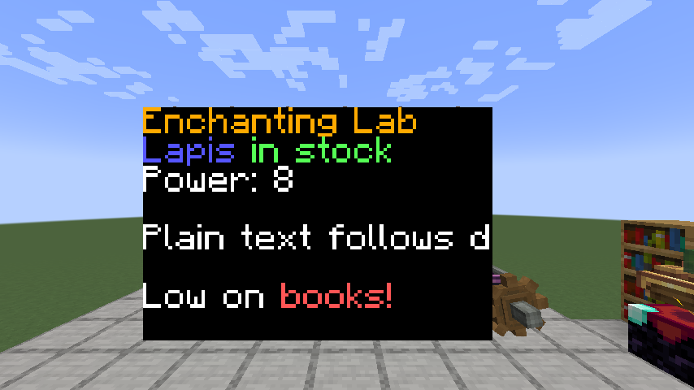
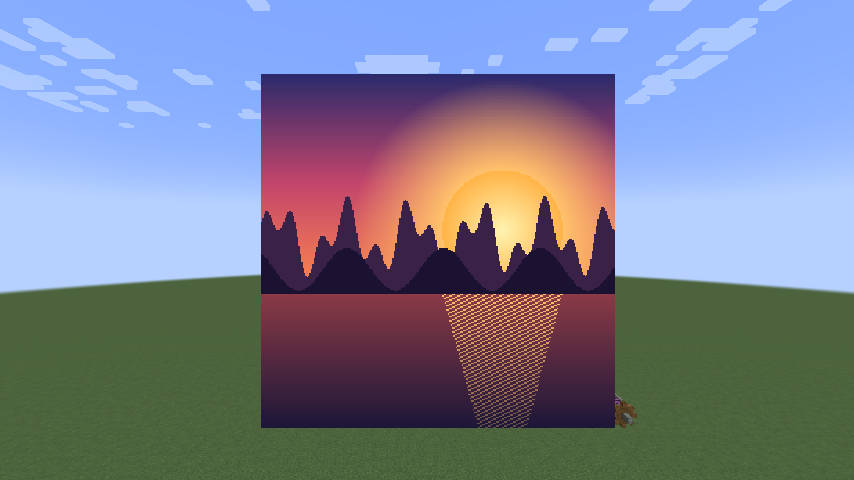
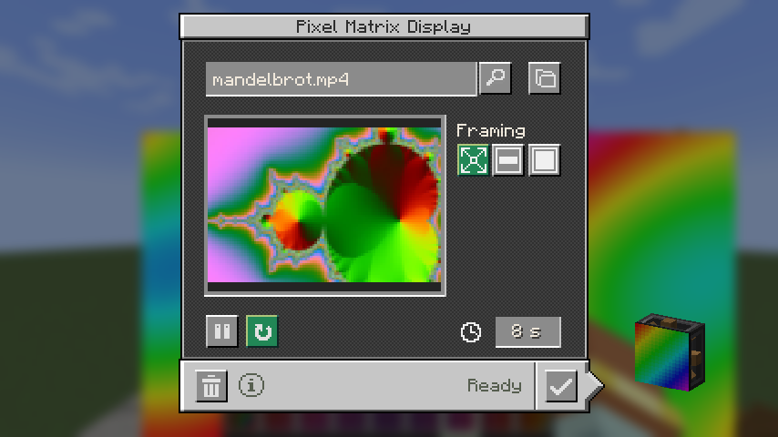
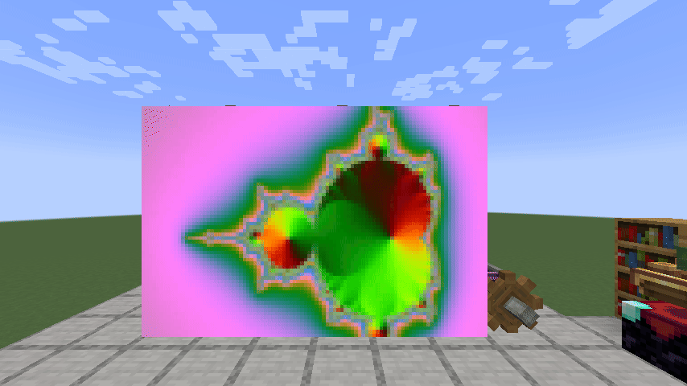
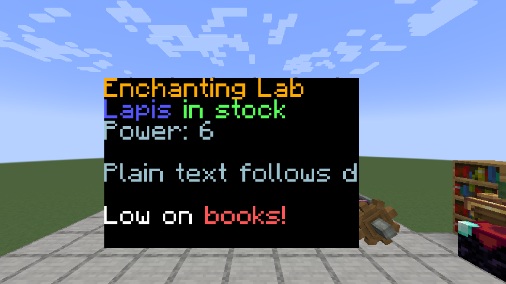
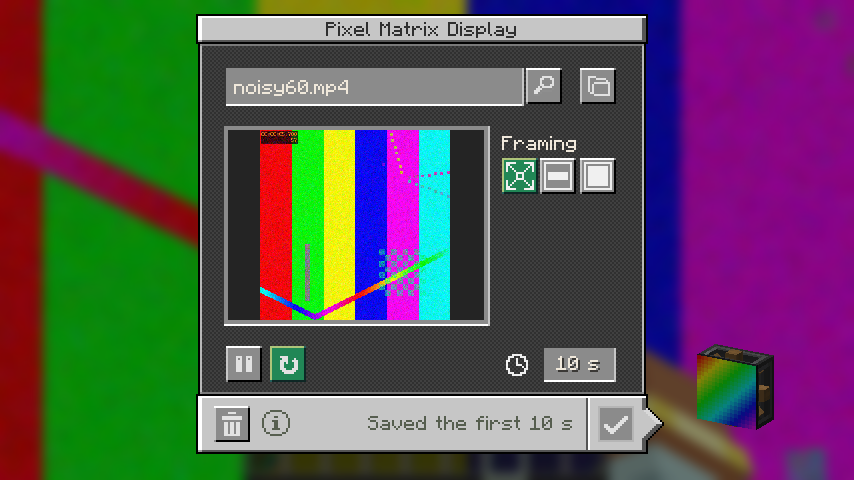
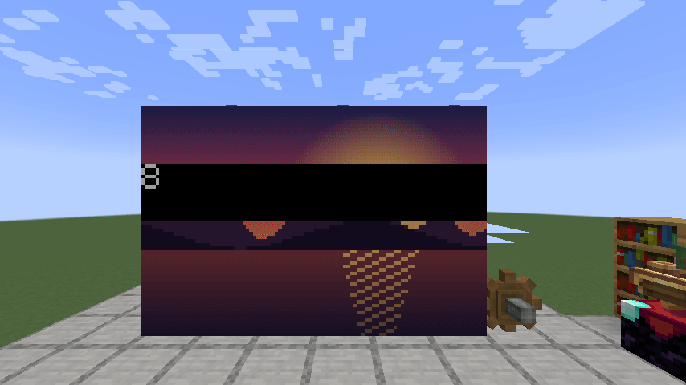
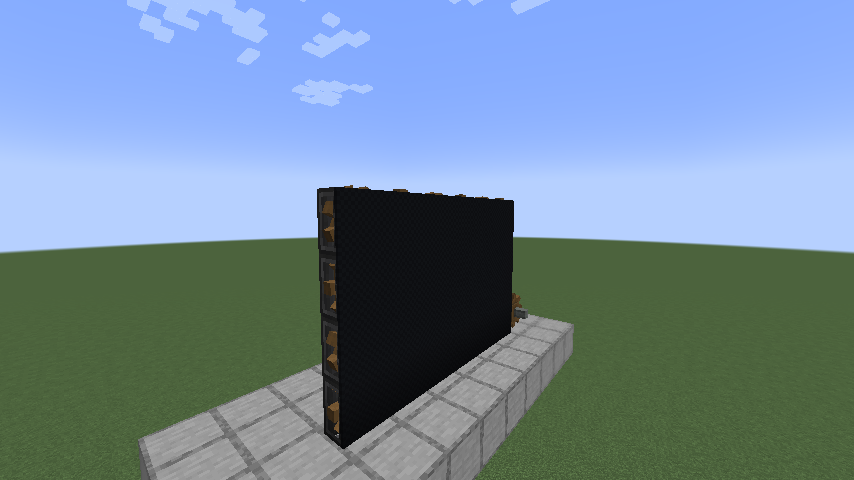
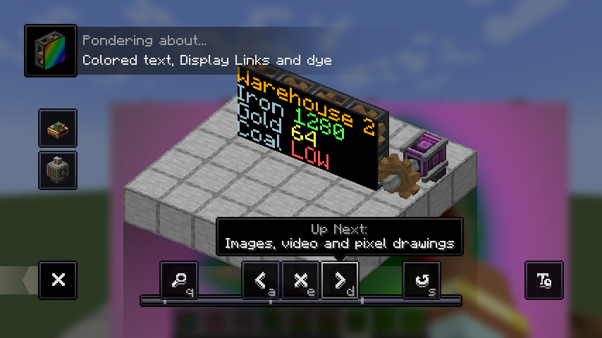
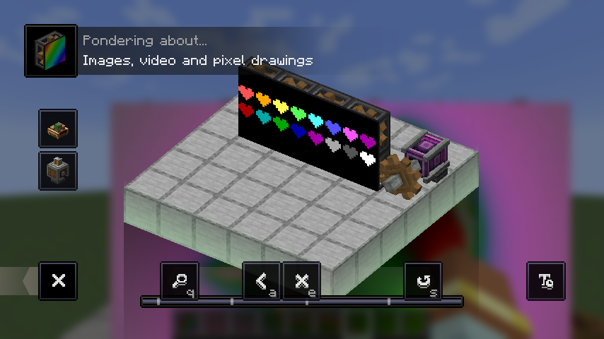

The Pixel Matrix Display is a new block, so there's no "before" to compare with.

| Colored text, a Display Link on line 3 | A 16 by 16 wall showing one picture |
| --- | --- |
|  |  |

| Importing a video | The video playing |
| --- | --- |
|  |  |

| Dye recolors plain text | A clip too large for the server is cut short |
| --- | --- |
|  |  |

| Losing rotation fades the screen out | Without rotation |
| --- | --- |
|  |  |

| Ponder: text | Ponder: media |
| --- | --- |
|  |  |

Frame times on a 16 by 16 wall (256 blocks), Flywheel instancing, measured back to back in one session:

| View | Flip-Dot Display | Pixel Matrix Display |
| --- | --- | --- |
| Nothing in view | 170 FPS | 124 FPS |
| Wall, holding still | 103 FPS | 122 FPS |
| Wall, playing a clip | 52 to 80 FPS | 99 to 148 FPS |
