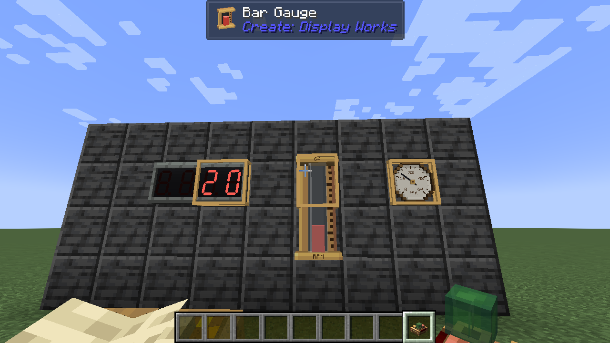
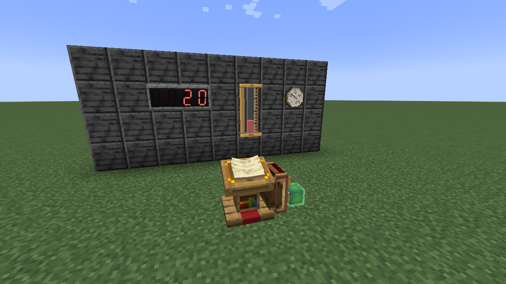
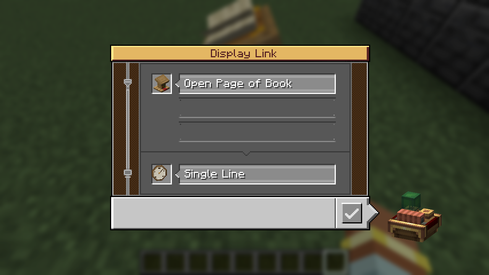
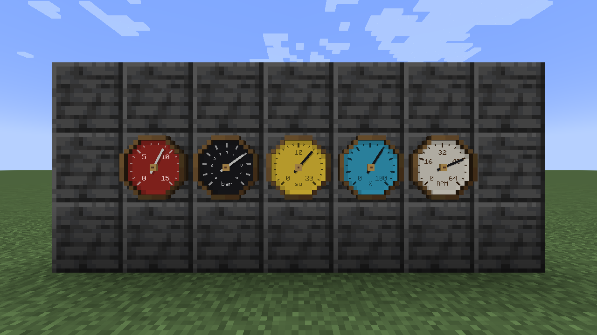
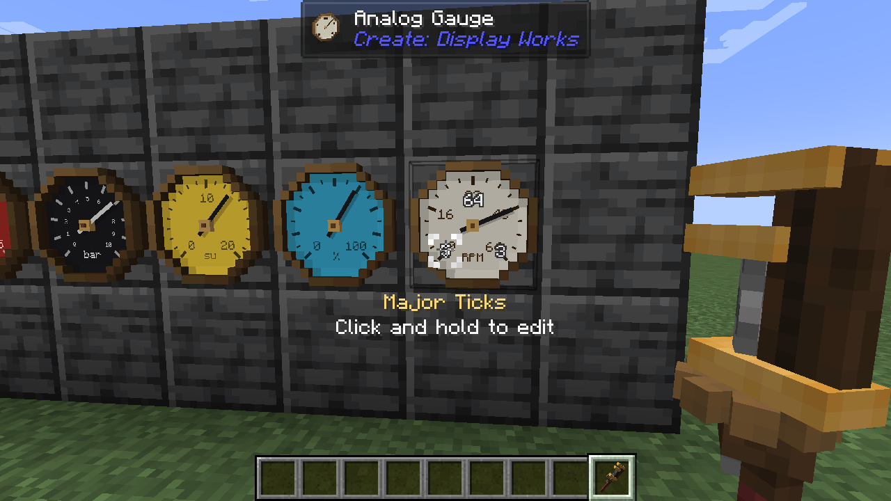
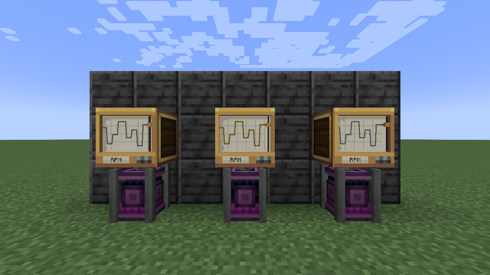
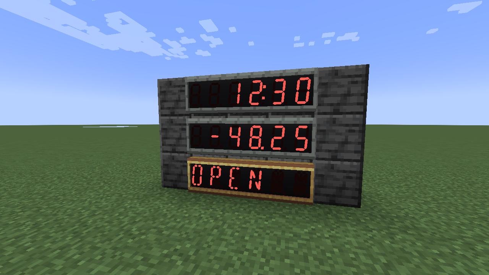
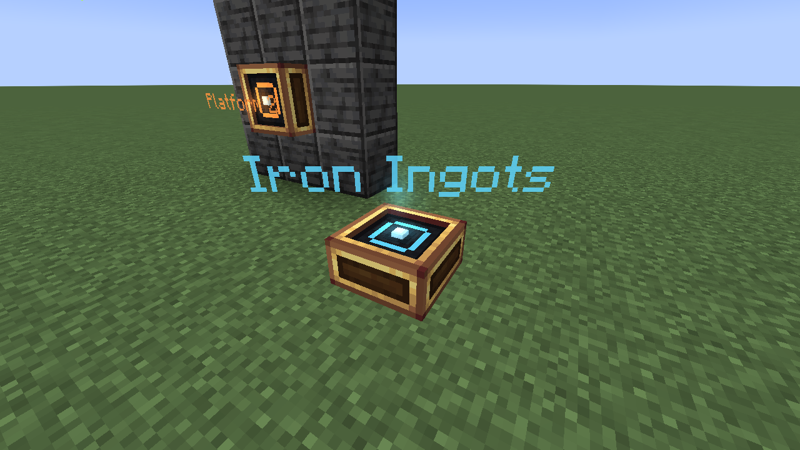
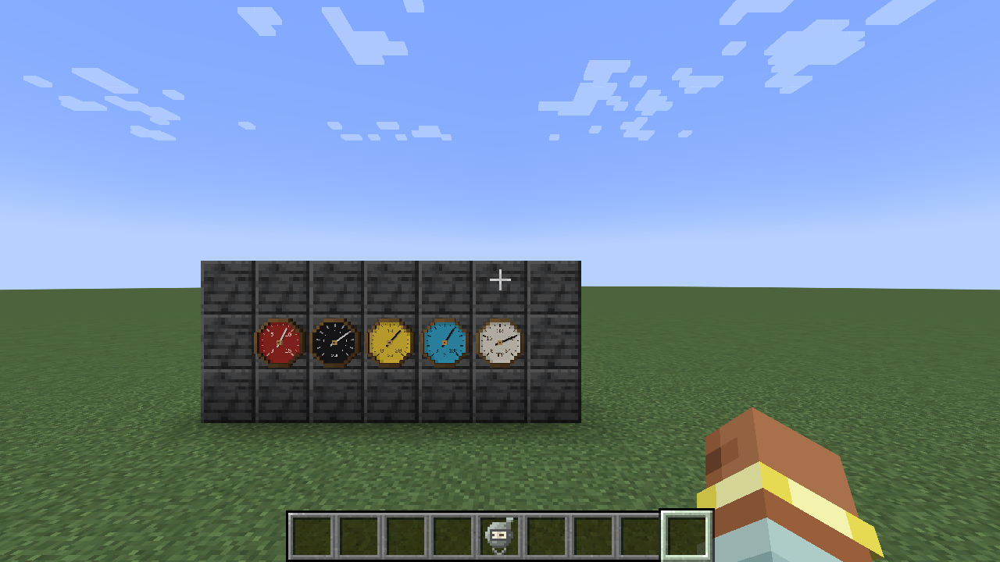

Twelve new display blocks, a Hand Tally, and two additions to Create's Display Link. They're all new, so there are no before images.

### Display Links

### Pixel Matrix Display

### Analog Gauge

### Bar Gauge

### Mechanical Counter

### Chart Recorder

### Split-Flap Display

### Andesite and Brass Segment Displays

### Indicator Light and Pilot Light

### Hologram Projector

### Projector

| Day | Night |
| --- | --- |
|  |  |

### Hand Tally

