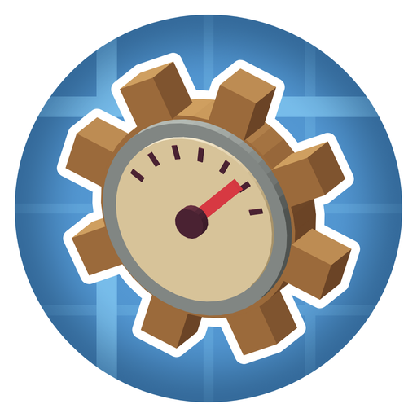

# Create: Display Works
Bring your Create factories to life with new and smarter display technology!

Flip-Dot Displays are implemented for Minecraft 1.21.1 and Create 6.0.10, with tileable 8×8 grids, dyeable discs, Display Link and clipboard input, media import, Ponder tutorials, and cog-driven disc motion and silent media playback at up to 10 FPS.

## 📊 Planned Features & Ideas
All items are subject to change or removal without notice.

### New Displays 📺
- Split-flap displays
- Segment displays
- Indicator lights
- Analog and bar guages
- Mechanical tickers/counters
- Chart recorders
- RGB pixel matrices
- Holograms
- Projectors

### New Technology 🛠️
- Display Controller (manage complex display logic)

### New Mechanics ⚙️
- Displays working on contraptions
- Expanded display sources & targets
- Display Link formatting language (formatting & number processing)
- Multi-source display targets

### Integrations & Compatibility 🔀
- Create Aeronautics compatibility

## 🧑‍💻 Development
See [DEVELOPMENT.md](DEVELOPMENT.md) for the hot-reloading dev client, the shared test world and the agent control API.
