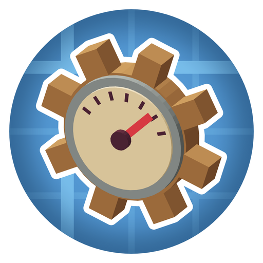

# Create: Display Works
Bring your Create factories to life with new and smarter display technology!

Flip-Dot Displays are implemented for Minecraft 1.21.1 and Create 6.0.10, with tileable 8×8 grids, dyeable discs, Display Link and clipboard input, media import, Ponder tutorials, and cog-driven disc motion and silent media playback at up to 10 FPS.

## 📊 Planned Features & Ideas
All items are subject to change or removal without notice.

### New Displays 📺
- Split-flap displays
- Segment displays
- Indicator lights
- Analog and bar guages
- Mechanical tickers/counters
- Chart recorders
- RGB pixel matrices
- Holograms
- Projectors

### New Technology 🛠️
- Display Controller (manage complex display logic)

### New Mechanics ⚙️
- Displays working on contraptions
- Expanded display sources & targets
- Display Link formatting language (formatting & number processing)
- Multi-source display targets

### Render Distance 🔭
A new kind of feature for this mod: changing how existing Create and Minecraft blocks draw, rather than adding new ones. The goal is for display blocks to stay visible out to the player's render distance, as flip-dot displays already do when Flywheel is available.

- Create display boards (currently 64 blocks)
- Create nixie tubes (currently 128 blocks)
- Other Create blocks that show information (still to be surveyed)
- Relevant Minecraft blocks, such as signs (still to be surveyed)
- The flip-dot fallback renderer used when Flywheel isn't available (currently 64 blocks)

Notes for when this is built:
- Measure first: use `/perf` on a wall of display boards, near and far, then decide whether this needs a client setting.
- Registering a renderer subclass that overrides `getViewDistance` looks possible without a mixin, but this is unconfirmed.
- The real limit becomes the client's render distance, because block entities further away aren't loaded. Distant Horizons won't show them.
- Create's flap animation runs in the client block entity tick, not while drawing, so off-screen boards don't fall behind.

### Integrations & Compatibility 🔀
- [Create Aeronautics](https://modrinth.com/mod/create-aeronautics) compatibility
- [Horizon](https://playhorizon.dev) support

## 🧑‍💻 Development
See [DEVELOPMENT.md](DEVELOPMENT.md) for the hot-reloading dev client, the shared test world and the agent control API.

To contribute, see [CONTRIBUTING.md](CONTRIBUTING.md), which also covers the screenshots and recordings PRs need.
